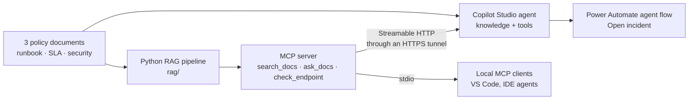

# Ops knowledge agent: Copilot Studio, RAG and MCP

One set of company documents, made answerable in three ways, from the fastest to deliver to the most reusable:

1. **Copilot Studio agent** (low-code): answers from the documents with citations and opens an incident
   through a Power Automate agent flow.
2. **Python RAG pipeline** (code): chunking, embeddings, retrieval and grounded generation, with a
   retrieval evaluation.
3. **MCP server** (interoperability): exposes the RAG pipeline and an ops check as tools that any MCP
   client can call, including the Copilot Studio agent itself.

The documents are three internal policies of a fictional logistics company in Seoul, *Hanbit Logistics*:
an incident runbook, a support and SLA policy, and a security and patch management policy.



## Repository layout

```
data/                        the 3 source documents (Markdown), indexed by the RAG pipeline
data/copilot-studio-upload/  the same documents as .docx, ready to upload to Copilot Studio
docs/copilot-studio.md       Copilot Studio agent configuration and test results
rag/rag_core.py              RAG pipeline: chunking, embeddings, search, cited generation
rag/ask.py                   command-line question answering
rag/eval_retrieval.py        retrieval evaluation on a 10-question golden set (Hit@1, Hit@3)
mcp_server/server.py         MCP server exposing 3 tools
mcp_server/test_client.py    MCP client that lists and calls every tool
```

## Quick start

Requires Python 3.10+.

```bash
python -m venv .venv && source .venv/bin/activate      # Windows: .venv\Scripts\activate
pip install -r requirements.txt

python rag/ask.py "How fast must we patch a critical CVE on an internet-facing server?"
python rag/eval_retrieval.py
```

Everything runs **without an API key**: retrieval falls back to TF-IDF and the answer is the best cited
passage. To get generated answers and semantic retrieval, configure OpenAI **or** Azure OpenAI
(see [`.env.example`](.env.example)):

```bash
# OpenAI
export OPENAI_API_KEY=...
# or Azure OpenAI (v1 API): model names are your deployment names
export AZURE_OPENAI_ENDPOINT=https://<resource>.openai.azure.com
export AZURE_OPENAI_API_KEY=...
export RAG_CHAT_MODEL=<chat deployment>
export RAG_EMBED_MODEL=<embedding deployment>
```

With a key, the retriever switches to embeddings automatically (`RAG_RETRIEVER=tfidf` forces offline mode).
Embeddings are cached in `.index/` and rebuilt when the documents or the model change.

## 1. Copilot Studio agent

The low-code version: a Standard Copilot Studio agent grounded on the three documents, with web search and
ungrounded answers disabled, and a Power Automate agent flow that opens an incident once the agent has
classified its severity from the runbook.

Full configuration, instructions and test results: [`docs/copilot-studio.md`](docs/copilot-studio.md).

| Test question | Result |
|---|---|
| Patch deadline for a critical CVE on an internet-facing server | 72 hours, cited |
| Service credit for an Enterprise customer at 98.5% availability | 25% of the monthly fee, cited |
| Parental leave policy (not in the documents) | Says it doesn't know, suggests HR |

## 2. RAG pipeline

[`rag/rag_core.py`](rag/rag_core.py) is a single readable file in four steps.

| Step | Choice | Why |
|---|---|---|
| Chunking | One chunk per section (`##` heading); long sections split on paragraphs with overlap | Policies are already split into meaningful sections, and tables stay whole |
| Context | Each chunk is embedded with its document title and section heading | A short section like "5. Rollback" is otherwise ambiguous |
| Retrieval | Embeddings + cosine similarity in numpy, or TF-IDF offline | 23 chunks fit in memory; no vector database needed at this size |
| Generation | Answer only from the retrieved passages, cite each fact, say "I don't know" otherwise | Grounding and traceability |
| Guardrail | Below a minimum relevance score, no LLM call at all | Fewer hallucinations, lower cost |

### Evaluation

[`rag/eval_retrieval.py`](rag/eval_retrieval.py) checks whether the right section comes back in the top results
for 10 questions with a known answer. Measuring retrieval separately from generation is the first step when a
RAG system gives wrong answers: if the right passage is not retrieved, no prompt will fix it.

Offline TF-IDF baseline: **Hit@1 9/10, Hit@3 9/10.**

The miss is instructive. *"How do I roll back a bad deployment?"* does not retrieve the Rollback section,
because the document writes "rollback" as one word and keyword search does not connect the two. This
vocabulary gap is what embeddings, or hybrid search (keyword + vector, as in Azure AI Search), are for.
Run the evaluation again with an API key to compare.

A second limit shows on out-of-scope questions: *"What is our parental leave policy?"* retrieves the access
control section offline, because it contains "people who **leave** the company". The relevance threshold
alone is not enough; the grounding instruction in the prompt is the second line of defence.

### Moving to production

- Replace the in-memory index with **Azure AI Search** (hybrid search + semantic ranker).
- Index from **SharePoint** with security trimming, so users only get answers from documents they can read.
- Run the golden set in CI on every change to documents, chunking or prompts, and track answer faithfulness
  as well as retrieval.

## 3. MCP server

[`mcp_server/server.py`](mcp_server/server.py) uses the official MCP Python SDK (v2). Tool schemas are
generated from Python type hints and Pydantic models; docstrings become the tool descriptions the model reads.

| Tool | What it does |
|---|---|
| `search_docs(query, k)` | Returns the most relevant passages with their source |
| `ask_docs(question)` | Returns a grounded, cited answer |
| `check_endpoint(url)` | Returns HTTP status, latency and days before the TLS certificate expires |

```bash
python mcp_server/server.py          # Streamable HTTP on http://127.0.0.1:8000/mcp
python mcp_server/test_client.py     # in a second terminal
```

### Security

A tool is code that a language model decides to run, so its inputs are treated as untrusted.

- **SSRF protection**: `check_endpoint` refuses private, loopback and link-local addresses (for example the
  cloud metadata endpoint `169.254.169.254`), accepts only `http`/`https`, and does not follow redirects.
- **Authentication**: with `MCP_API_KEY` set, every HTTP request needs the `x-api-key` header.
- **DNS rebinding protection**: only local Host headers are accepted, plus the host passed with `--public-host`.
- **Stateless HTTP**: no server-side session, so the server works behind tunnels and load balancers.

### Local MCP client (stdio)

Example for VS Code (`.vscode/mcp.json`):

```json
{
  "servers": {
    "hanbit-ops": {
      "type": "stdio",
      "command": "${workspaceFolder}/.venv/bin/python",
      "args": ["${workspaceFolder}/mcp_server/server.py", "--transport", "stdio"]
    }
  }
}
```

### Copilot Studio (Streamable HTTP)

Copilot Studio only accepts the Streamable HTTP transport, on a public HTTPS URL.

```bash
# Terminal 1: HTTPS tunnel (no account needed)
cloudflared tunnel --url http://localhost:8000

# Terminal 2: the server, accepting the tunnel host and requiring a key
MCP_API_KEY=<choose-a-key> python mcp_server/server.py --public-host <xxx>.trycloudflare.com
```

Then in Copilot Studio: agent > **Tools** > **Add a tool** > **New tool** > **Model Context Protocol**,
URL `https://<xxx>.trycloudflare.com/mcp`, API key authentication with header `x-api-key`.
Details in [`docs/copilot-studio.md`](docs/copilot-studio.md#4-tool-the-python-mcp-server).

## Notes

- Hanbit Logistics and its documents are fictional; any resemblance to a real company is coincidental.
- Default model names (`gpt-4.1-mini`, `text-embedding-3-small`) can be overridden with `RAG_CHAT_MODEL` and
  `RAG_EMBED_MODEL`.
