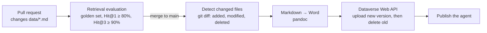

# Knowledge CI/CD: from a Git push to the Copilot Studio agent

Documents live in [`data/`](../data/) as Markdown, under version control. The
[`Knowledge sync`](../.github/workflows/knowledge-sync.yml) workflow treats them like code:



- **Pull request**: the evaluation runs as a quality gate. If a change makes the right passages harder to find
  (for example a document deleted while the golden set still asks about it), the check fails.
- **Push to `main`**: the changed documents are converted to `.docx` and pushed to the agent; deleted
  documents are removed from it. The agent is then published.
- **Manual run** (Actions > Knowledge sync > Run workflow): tick *full sync* to re-upload every document.

The workflow skips the sync step, without failing, as long as the settings below are not configured.

## How the sync works

Copilot Studio stores each uploaded knowledge file as a row of the Dataverse `botcomponents` table
(`componenttype` 14, "Bot File Attachment"), linked to the agent, with the file in the `filedata` column.
[`scripts/sync_copilot_knowledge.py`](../scripts/sync_copilot_knowledge.py) reproduces the upload button:

1. create a new component row and upload the file into it;
2. delete the previous version of the same file, after the upload, so the agent always has the document;
3. publish the agent (`PvaPublish`).

Indexing takes a few minutes, as with a manual upload. The test pane in Copilot Studio uses the latest draft,
so it sees the new content even when publishing is not allowed (Copilot Studio trials cannot publish by
default; the workflow then logs a warning instead of failing).

This relies on the Dataverse tables behind Copilot Studio, not on a dedicated documented API, so it should be
re-tested after major Copilot Studio updates. For permission-aware knowledge at scale, a SharePoint library as
the knowledge source is the alternative (Copilot Studio re-syncs it every few hours).

## One-time setup (about 15 minutes)

### 1. App registration in Microsoft Entra

1. Entra admin center > **App registrations** > **New registration**, name `github-knowledge-sync`,
   single tenant.
2. Note the **Application (client) ID** and the **Directory (tenant) ID**.
3. **Certificates & secrets** > **New client secret**. Copy the secret **value** now; it is shown only once.

No API permission is needed: access to Dataverse is granted in the next step.

### 2. Application user in the Power Platform environment

1. Power Platform admin center > **Environments** > your environment > **Settings** > **Users + permissions**
   > **Application users** > **New app user**.
2. Add the `github-knowledge-sync` app, pick the business unit, and give it a security role.
   For a demo environment: **System Administrator**. In production: a custom role limited to read and write on
   the **Copilot** (`bot`) and **Copilot component** (`botcomponent`) tables.

### 3. Repository variables and secrets

GitHub repository > **Settings** > **Secrets and variables** > **Actions**.

**Variables** tab (not sensitive):

| Variable | Value |
|---|---|
| `DATAVERSE_URL` | Environment URL, e.g. `https://orgxxxxxxxx.crm12.dynamics.com` (Power Platform admin center > environment > Environment URL) |
| `COPILOT_AGENT_ID` | The GUID after `/bots/` in the agent's Copilot Studio URL |
| `AZURE_TENANT_ID` | Directory (tenant) ID |
| `AZURE_CLIENT_ID` | Application (client) ID, not the object ID |

**Secrets** tab, the only sensitive value:

| Secret | Value |
|---|---|
| `AZURE_CLIENT_SECRET` | Client secret **value** (not the secret ID) |

### 4. Check

Locally, with the same variables exported:

```bash
python scripts/sync_copilot_knowledge.py --list                         # agent's current files
python scripts/sync_copilot_knowledge.py data/copilot-studio-upload/*.docx --dry-run
```

Then edit a document in `data/`, push to `main`, and follow the run in the **Actions** tab.

## Production improvements

- Replace the client secret with **workload identity federation** (a federated credential on the app
  registration trusting this repository), so no secret is stored in GitHub.
- Protect the sync job with a GitHub **environment** that requires an approval before production.
- Keep the golden set next to the documents and require new questions when a document is added.
